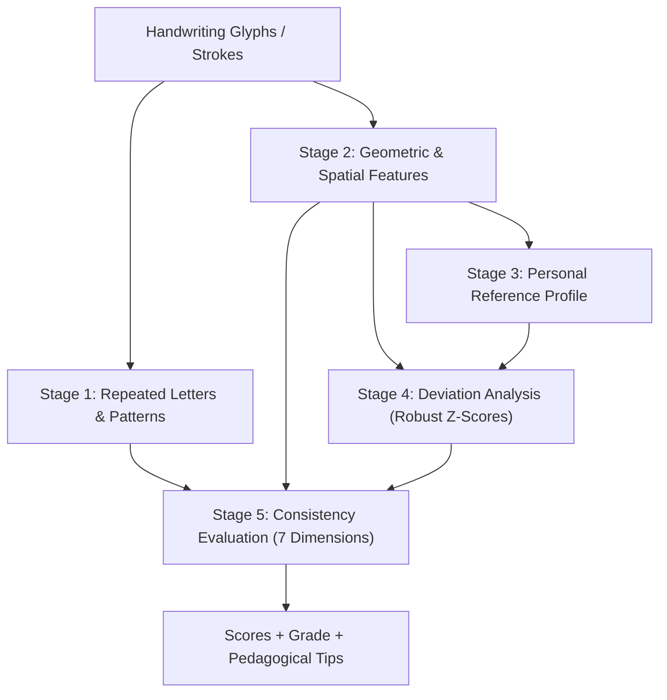

# RapidWrite Standalone Aesthetic Evaluation Algorithm

This folder contains a **standalone, zero-dependency reference implementation** of the RapidWrite 5-Stage Handwriting Aesthetic Evaluation Algorithm.

You can freely share this folder or its individual script files with your friends, researchers, instructors, or classmates.

---

## 📁 What's Included

| File | Purpose | Environment |
| :--- | :--- | :--- |
| **`rapidwrite_aesthetic_algorithm.js`** | Standalone JavaScript/Node.js implementation with interactive self-test demo | Node.js (v14+) or Web Browser Console |
| **`rapidwrite_aesthetic_algorithm.py`** | Standalone Python 3 implementation with interactive self-test demo | Python 3.7+ (Pure Standard Library) |
| **`ALGORITHM_SPECIFICATION.md`** | Complete scientific specification, mathematical formulas, and empirical constants | Markdown / Documentation |
| **`README.md`** | Getting started guide and usage examples | Documentation |

> [!NOTE]
> **Zero External Dependencies**: Neither script requires `npm install` or `pip install`. They only use standard, built-in features (`math`, `re`, `json` in Python; pure built-in JavaScript in Node.js).

---

## 🚀 Quick Start: Running the Demos

### Option 1: Running with Python
Open your terminal inside this folder and run:
```bash
python rapidwrite_aesthetic_algorithm.py
```
*(or `python3 rapidwrite_aesthetic_algorithm.py` on Mac/Linux)*

### Option 2: Running with Node.js
Open your terminal inside this folder and run:
```bash
node rapidwrite_aesthetic_algorithm.js
```

Both scripts run a built-in end-to-end evaluation demonstration showing:
1. Stage 1 repeated letter pattern identification.
2. Stage 2 geometric feature extraction (local heights/slants + global baseline drift).
3. Stage 3 personal reference profile calibration.
4. Stage 4 robust Z-score deviation analysis.
5. Stage 5 multi-dimensional scoring (7 dimensions) + letter grade + pedagogical feedback.

---

## 💻 How to Use in Your Own Project

### Using in Python
```python
from rapidwrite_aesthetic_algorithm import RapidWriteAestheticAlgorithm

# 1. Provide extracted glyphs {x, y, width, height, slantAngleDeg}
glyphs = [
    {"x": 50, "y": 120, "width": 22, "height": 38, "slantAngleDeg": 12.0},
    {"x": 74, "y": 132, "width": 16, "height": 26, "slantAngleDeg": 11.5},
    # ... more glyphs
]

target_sentence = "Students attend classes every day to gain knowledge and develop new skills."

# 2. Run full 5-stage evaluation in one call
result = RapidWriteAestheticAlgorithm.evaluate(
    glyphs=glyphs,
    target_sentence=target_sentence,
    cohort="Senior / College"  # or "Elementary / Middle School"
)

scores = result["stage5_scores"]
print(f"Overall Aesthetic Score: {scores['overall_aesthetic_score']} (Grade: {scores['grade']})")
print(f"Readability:             {scores['readability_score']}")
print(f"Baseline Alignment:      {scores['alignment_score']}")
print(f"Coaching Tips:           {scores['coaching_tips']}")
```

### Using in JavaScript / Node.js
```javascript
const RapidWriteAestheticAlgorithm = require('./rapidwrite_aesthetic_algorithm');

// 1. Provide extracted glyphs
const glyphs = [
  { x: 50, y: 120, width: 22, height: 38, slantAngleDeg: 12.0 },
  { x: 74, y: 132, width: 16, height: 26, slantAngleDeg: 11.5 },
  // ... more glyphs
];

const targetSentence = "Students attend classes every day to gain knowledge and develop new skills.";

// 2. Run full 5-stage evaluation
const result = RapidWriteAestheticAlgorithm.evaluate({
  glyphs,
  targetSentence,
  cohort: 'Senior / College' // or 'Elementary / Middle School'
});

console.log('Overall Score:', result.stage5Scores.overallAestheticScore);
console.log('Grade:', result.stage5Scores.grade);
console.log('Coaching Tips:', result.stage5Scores.coachingTips);
```

---

## 🧠 The 5 Mandatory Algorithm Stages



1. **Stage 1 – Repeated Letters & Common Stroke Patterns**:
   - Matches detected character blocks against expected target sentence letters.
   - Groups repeated instances of common letters (`'e'`, `'t'`, `'s'`, `'a'`, `'o'`, etc.).
   - Computes within-letter height variance and slant consistency to measure stroke motor control.

2. **Stage 2 – Geometric Feature Extraction (Local & Global)**:
   - **Local**: Median height, height MAD, median width, aspect ratio ($\text{width}/\text{height}$), and stroke slant angle ($\theta$).
   - **Global**: Inter-glyph & inter-word spacing regularity, line spacing, and baseline drift ($\sigma_{\text{baseline}}$) via linear regression on line contact points.

3. **Stage 3 – Personal Reference Profile Construction**:
   - Uses non-parametric **Median** and **Median Absolute Deviation (MAD)**:
     $$\text{MAD} = \operatorname{median}(|x_i - \operatorname{median}(X)|)$$
   - Establishes natural personal tolerance intervals: $[\text{median} - 2\cdot\text{MAD}, \; \text{median} + 2\cdot\text{MAD}]$.
   - Infers qualitative personal style tags (e.g. *Forward Italic*, *Upright Print*, *Steady Baseline*) without penalizing natural human variation.

4. **Stage 4 – Deviation Analysis from Personal Reference Profile**:
   - Computes robust Z-scores against the student's personal baseline:
     $$Z = \frac{|x_{\text{current}} - \text{median}_{\text{ref}}|}{1.4826 \times \text{MAD}_{\text{ref}}}$$
   - **Zero-Penalty Tolerance**: Variations with $|Z| \le 1.5$ represent natural human stylistic breathing room with $0$ penalty.

5. **Stage 5 – Consistency Evaluation & Multi-Dimensional Scoring (7 Dimensions)**:
   - Evaluates 7 validated dimensions:
     1. **Readability Score (22%)**
     2. **Letter Formation Score (18%)**
     3. **Baseline Alignment Score (18%)**
     4. **Consistency Score (16%)**
     5. **Spacing Score (14%)**
     6. **Visual Organization Score (12%)**
   - **Age-Cohort Normalization**: Calibrated for younger elementary/middle school students writing on unlined paper vs. senior students on lined paper, ensuring children are evaluated fairly based on readability and distinguishability rather than adult lined-paper standards.

---

## 📊 Dataset Validation Summary (84 Segmented Students)

The algorithm constants were calibrated on 84 segmented student handwriting samples across 33 PDF pages:
- **C1 Cohort (Senior / College)**: 60 samples on lined paper.
- **School Cohort (Elementary / Middle)**: 24 samples on unlined paper.

| Cohort | Samples | Mean Aesthetic Score | Readability | Alignment | Grade Distribution |
| :--- | :---: | :---: | :---: | :---: | :--- |
| **C1 Senior** | 60 | **80.1** (Median: 83.8) | 84.3 | 78.5 | A+: 2, A: 22, B+: 16, B: 12, C+: 6, C: 2 |
| **School Students** | 24 | **65.5** (Median: 66.3) | 68.4 | 63.5 | A: 1, B+: 1, B: 6, C+: 9, C: 7 |
| **All Combined** | 84 | **75.9** (Median: 77.3) | 79.8 | 74.2 | Natural bell curve (A+: 2.4%, A: 27.4%, B+: 20.2%, B: 21.4%, C+: 17.9%, C: 10.7%) |
